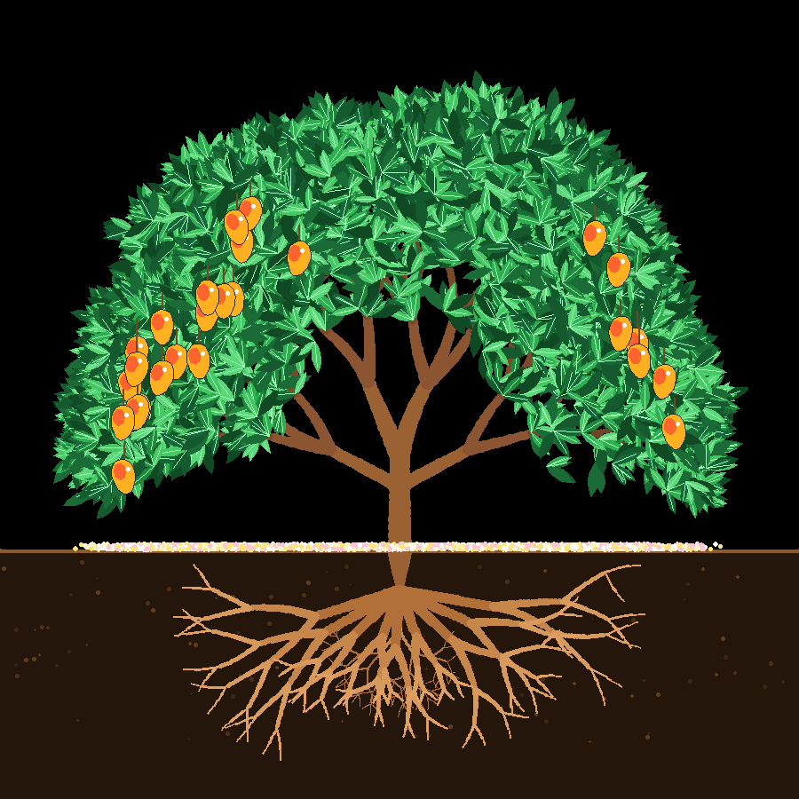

# Pohon Mangga — Python Turtle Animation

Animasi pertumbuhan pohon mangga dari benih sampai berbuah, digambar dengan modul `turtle`
bawaan Python. Tanpa pustaka tambahan.

*An animation of a mango tree growing from seed to fruit, drawn with Python's built-in `turtle` module.*



## Tahapan

1. Petani bercaping datang membawa cangkul, menggali lubang, menanam benih, menyiramnya dengan gembor, lalu pergi
2. Akar tumbuh dari benih ke dalam tanah
3. Tunas muncul ke permukaan
4. Batang cokelat tumbuh dari tengah tunas hijau hingga menutupinya, lalu bercabang (termasuk dua dahan besar kiri-kanan); akar ikut menjalar lebar
5. Daun tumbuh rimbun ke atas dan ke samping
6. Bunga mangga bermekaran
7. Bunga rontok melayang dan berserakan warna-warni di tanah, lalu buah mangga tumbuh
8. Mangga matang, siap dipanen

## Menjalankan

```bash
git clone https://github.com/des1susanti/turtle-animation-pohon.git
cd turtle-animation-pohon
python3 pohon_mangga.py
```

Tombol: **R** = ulangi animasi, **Q** = keluar.

## Pengaturan

Di bagian atas `pohon_mangga.py`:
- `DELAY` — perbesar (mis. `0.05`) agar animasi lebih lambat.
- `SEED` — ganti angkanya untuk bentuk pohon yang berbeda.
- Warna daun, bunga, dan mangga: `LEAF_COLORS`, `FLOWER_COLORS`, `MANGO_RAW`, `MANGO_RIPE`.

Jika muncul error `No module named '_tkinter'` (Python dari Homebrew): `brew install python-tk`.
